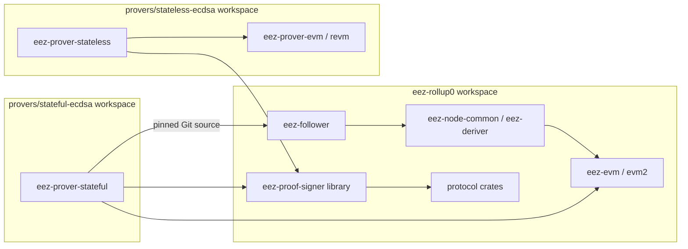

# Provers

Both ECDSA backends live in [eez-association/provers](https://github.com/eez-association/provers),
pinned here as the `provers/` submodule. Each has its own Cargo workspace and lockfile:

| Workspace | Binary | Execution |
| --- | --- | --- |
| `provers/stateless-ecdsa/` | `eez-proof-signer` (`eez-prover-stateless` package) | Witness replay using `eez-prover-evm`, revm 43 and reth 2.7 |
| `provers/stateful-ecdsa/` | `eez-prover-stateful` | Default follower and existing stateful backend using `eez-evm`, evm2 and reth 2.11 |

The ordinary `eez-follower` library and binary stay in this repository. Stateful
imports that library at a pinned Git revision. `eez_follower::run_with` validates
caller configuration before node startup and provides handles after historical
synchronization and L1 anchoring. Stateful attaches its service there and drains
it during node shutdown. The hook does not customize execution: both binaries
run the same default follower.

The execution-independent `eez-proof-signer` library also stays here. Both prover
workspaces import it for admission, settlement checks, streaming gRPC, public
inputs and attestations. The follower has no dependency on that library or either
prover. There is no root-to-prover Cargo dependency.



## Building and testing here

```bash
git submodule update --init provers
scripts/provers-cargo.sh build --target-dir target -p eez-prover-stateless --bins
scripts/provers-cargo.sh --stateful build --target-dir target -p eez-prover-stateful --bins
scripts/provers-cargo.sh nextest run --target-dir target --workspace
scripts/provers-cargo.sh --stateful nextest run --target-dir target --workspace
```

The helper redirects the shared signing and protocol crates to this checkout.
Each workspace keeps its execution-dependent crates at its own Git pin, so a
later reth upgrade in root does not force either prover to upgrade. The helper
restores the selected lockfile on exit; redirected builds cannot use `--locked`.
For standalone builds, run Cargo inside the selected prover directory with
`--locked`. Updating follower code used by stateful requires advancing its root
Git pin and matching reth/evm2 dependencies in `stateful-ecdsa/Cargo.toml`.

The e2e harness locates both executables beside the test profile or builds them
through the helper. `EEZ_TEST_PROOF_SIGNER_BIN` and
`EEZ_TEST_STATEFUL_PROVER_BIN` override their paths. Docker targets are
`proof-signer` and `stateful-prover`. Kurtosis `prover_backend: stateful` uses
the `stateful_prover_image` setting and runs `eez-prover-stateful node ...`.

## Migrating an existing stateful signer

Replace `eez-follower node ...` with `eez-prover-stateful node ...`, preserving
the chain, compatible datadir, L1 endpoints and `EEZ_STATEFUL_PROOF_SIGNER_*`
settings. The signer address and key are required; the ordinary follower rejects
them with a migration error. `EEZ_SEQUENCER_ADDRESS` is forbidden for proving.
Peer-assisted historical synchronization remains supported; `EEZ_SYNC_L1_ONLY`
is optional. L1 may be remote over RPC, with trace RPC and beacon access as
required by the posted data. The prover still owns its local L2 database.

## Updating both repositories

Publish the follower API commit here first, then pin it in stateful's workspace.
Merge the prover changes, update this repository's submodule to the resulting
provers commit, and merge the root integration. The initial API commit can be
published on the root PR branch before the root PR merges. Keep that commit
reachable, or repin stateful to a compatible merged root revision if squashing.
If the prover PR is squashed, update the root gitlink to its merge SHA.

Execution-rule changes still need matching behavior in root `eez-evm` and
stateless `eez-prover-evm`. Both replay
`provers/stateless-ecdsa/testing/evm-golden/execution.json`; the stateless workspace
owns the fixtures. Stateful uses root's EVM directly. Refresh stateless's copies
of streaming conformance vectors when the wire contract changes.
