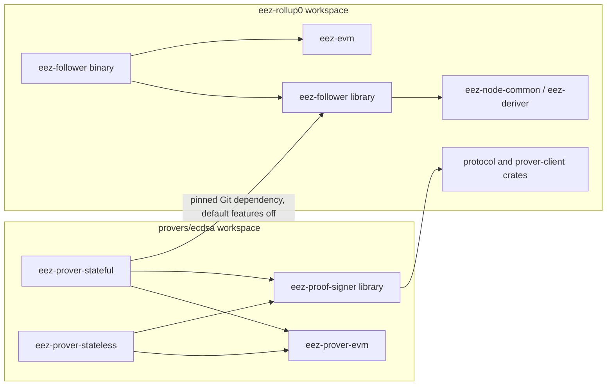

# Provers

Both ECDSA backends live in [eez-association/provers](https://github.com/eez-association/provers),
in one `ecdsa/` workspace and lockfile, pinned here as the `provers/` submodule:

- `eez-proof-signer` (package `eez-prover-stateless`) replays streamed witnesses.
- `eez-prover-stateful` runs a revm follower and signs against its local database.
- `eez-proof-signer` is also the shared library for admission, settlement checks,
  streaming gRPC, public inputs and attestations. Both backends use it.
- `eez-prover-evm` supplies execution to both backends, including the stateful
  engine, payload builder, L1 deriver and checkpoint replay.

The ordinary `eez-follower` binary stays here and uses `eez-evm`. Its library
has no dependency on a prover. `eez_follower::run_with` accepts the caller's
EVM, RPC transaction converter and a callback with the provider, chain spec, committer and task executor
once historical synchronization and L1 anchoring finish. The stateful binary
attaches its service through that callback and drains it during node shutdown.



## Independent execution versions

The prover workspace pins reth v2.7.0 (`fa9e76a`), revm 43 and the stateless
fork (`935f25a`). Its follower/support crates are Git dependencies on a specific
**eez-rollup0 revision**. They inherit that revision's root manifest, including
its reth requirements. A newer root checkout can therefore build evm2 while
both provers retain evm1. The prover owns its reth patches and lockfile; there
is one reth source per executable graph and no root-to-prover Cargo dependency.

Shared protocol crates (`eez-primitives`, `eez-protocol`, `eez-payload-codec`,
`eez-blob`, `eez-control-rpc`, `eez-prover`, `eez-prover-client`) must remain free
of git-pinned reth/EVM dependencies. `eez-primitives` exposes revm conversions
through its optional `revm` feature. Their version requirements must be compatible
with both workspaces even when their source is redirected to a newer checkout.

## Building and testing here

```bash
git submodule update --init provers
scripts/provers-cargo.sh build --target-dir target -p eez-prover-stateless -p eez-prover-stateful --bins
scripts/provers-cargo.sh nextest run --target-dir target --workspace
```

The helper redirects only the protocol crates to this checkout. It keeps the
reth-dependent follower closure at the prover's Git pin. It restores the prover
lockfile on exit, so these redirected builds cannot use `--locked`.
For changes to follower internals on a **compatible reth revision**, explicitly
set `EEZ_PROVERS_FOLLOWER_SOURCE` to that checkout's absolute path. Do not set it
to an evm2 checkout when testing the revm prover.

The e2e harness locates both executables beside the test profile, or builds them
through the helper. `EEZ_TEST_PROOF_SIGNER_BIN` and
`EEZ_TEST_STATEFUL_PROVER_BIN` override their paths. Docker targets are
`proof-signer` and `stateful-prover`. Kurtosis `prover_backend: stateful` uses
the `stateful_prover_image` setting and runs `eez-prover-stateful node ...`.

## Migrating an existing stateful signer

Replace `eez-follower node ...` with `eez-prover-stateful node ...`, preserving
the chain, datadir, L1 endpoints and `EEZ_STATEFUL_PROOF_SIGNER_*` settings.
The signer address and key are required; the ordinary follower rejects them
with a migration error. `EEZ_SEQUENCER_ADDRESS` is forbidden for proving.
Peer-assisted historical synchronization remains supported; `EEZ_SYNC_L1_ONLY`
is optional. L1 may be remote over RPC, with trace RPC and beacon access as
required by the posted data. The prover still owns its local L2 database.

## Updating both repositories

Publish shared follower changes here first and keep the compatible commit
reachable. Pin that revision in the prover workspace, test and merge the prover
changes, then land this repository's submodule update. For the initial migration,
the API commit can be published on the root PR branch before that PR merges.
Preserve it with a merge commit or a lasting compatibility ref; a squash of the
evm2 integration is not a compatible replacement for the prover's revm source pin.
If the prover PR is squashed, update the root gitlink to its resulting merge SHA.
If root has changed reth APIs, port shared follower fixes to the compatible
revision before moving the prover pin; do not replace its execution stack just
to consume a newer follower source revision.

Execution-rule changes land in root `eez-evm` and prover `eez-prover-evm` together.
Both replay `provers/ecdsa/testing/evm-golden/execution.json`; only the prover
workspace records these fixtures. Refresh the prover's copies of the streaming
conformance vectors when the wire contract changes. The EVM version is chosen
at build time by each binary, with no runtime EVM selector.
